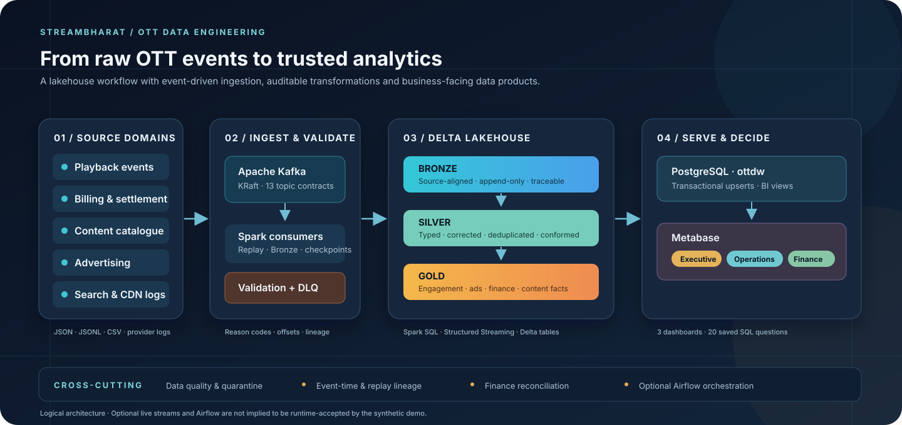

# StreamBharat
### OTT data engineering · lakehouse analytics · event-driven BI

**StreamBharat turns fragmented OTT activity data into reliable analytical datasets and business-facing insight.** It combines a PySpark/Delta Lake workbook implementation with a Kafka-based ingestion extension and a PostgreSQL/Metabase serving layer.

> **Project boundary:** This repository contains two related tracks: the original Q1–Q20 OTT analytics coursework and a Kafka ETL / local BI extension. The local synthetic Kafka-to-BI vertical slice has been exercised and verified. The full supplied course dataset, all Q1–Q20 business outputs, continuous-stream acceptance and production deployment are separate, unfinished validation milestones.

---

## The problem this project addresses

An OTT service does not operate from one tidy table. Playback events, subscriptions, payment settlements, content metadata, search behaviour, advertising delivery and CDN logs arrive in different formats, at different times, and with different quality problems.

StreamBharat builds the data foundation needed to answer questions such as:

- What are viewers actually watching, and how much of it do they complete?
- Which titles, languages, regions and search terms are performing well?
- Which subscription events reconcile to successful gateway settlements?
- Are ad breaks being filled and impressions being delivered within campaign limits?
- How should subscription revenue be allocated to content partners?
- Which users may be at risk of churn, and which titles could be recommended?
- Can invalid events, delayed arrivals and source-to-lakehouse gaps be identified rather than silently lost?

The output is a set of reusable facts, aggregates, model outputs and warehouse tables—not just a collection of one-off Spark scripts.

## What the platform delivers

| Business capability | What StreamBharat implements | Workbook questions |
|---|---|---|
| **Content intelligence** | Flatten nested catalogue data, preserve title/episode relationships, track content and licence history, analyse search gaps and rank titles by audience. | Q1, Q7, Q8, Q10 |
| **Playback and engagement** | Clean duplicate events, correct unreliable device clocks, ingest incrementally, construct viewing sessions and calculate watch-time and active-user metrics. | Q2, Q4, Q5, Q9 |
| **Subscriber and revenue analytics** | Derive subscription lifecycle periods, apply payment-failure grace rules, calculate cohorts and MRR movement, reconcile settlements and allocate partner royalties. | Q6, Q11, Q15 |
| **Advertising measurement** | Match ad breaks to impressions, calculate delivery/fill and campaign performance, inspect frequency-cap violations and model live pacing. | Q13, Q18 |
| **Platform operations** | Standardise multiple CDN log formats, report regional egress/cost and compare Spark skew/AQE/salting strategies. | Q3, Q14 |
| **Personalisation and retention** | Build implicit-feedback recommendations with Spark MLlib ALS and a time-aware churn classifier with prioritised risk scores. | Q16, Q20 |
| **Trust and governance** | Quarantine invalid records, enforce kids-safety and data-quality rules, and compare recomputed metrics with published references. | Q19 |
| **Near-real-time insight** | Calculate event-time trending windows and growth against a historical baseline. | Q17 |

The Kafka extension adds source-topic replay, append-only Bronze ingestion, DLQ routing, offset reconciliation, Silver/Gold transformations, warehouse upserts and a dashboard-ready serving layer. See the [solution overview](docs/solution-overview.md) for the full capability map and implementation boundaries.

## Architecture at a glance

### 1. Workbook / lakehouse analytics track

The original coursework track uses the supplied file dataset, PySpark, Delta Lake and Spark MLlib. Q17 and Q18 are separate long-running Structured Streaming jobs driven by the supplied simulator; they are not part of the finite batch orchestrator.

~~~mermaid
flowchart LR
    SRC["OTT source files JSON · JSONL · CSV · CDN logs"] --> ING["Schema-aware ingestion batch + incremental"]
    ING --> BR["BRONZE source-aligned records"]
    BR --> SI["SILVER clean · typed · deduplicated"]
    SI --> GO["GOLD business facts + aggregates"]
    GO --> BI["Business reporting"]
    GO --> ML["ALS recommendations Churn scoring"]
    SRC --> Q["Quality + reconciliation"]
    BR --> Q
    SI --> Q
    GO --> Q
    Q --> OUT["Exceptions · gates · audit outputs"]
    SIM["Simulator files"] --> RT["Q17 trending Q18 ad pacing"]
    RT --> GO
~~~

### 2. Kafka ETL / local BI extension

The extension introduces event replay and topic contracts, a Spark-based Bronze/DLQ path, and a PostgreSQL warehouse queried by Metabase. Airflow is an optional orchestration layer.

~~~mermaid
flowchart LR
    FEEDS["Seven source feeds"] --> REPLAY["Replay producer"]
    REPLAY --> KAFKA[("Kafka · KRaft 13 topic contracts")]
    KAFKA --> BRONZE["Spark Bronze consumers"]
    KAFKA --> VALIDATE["Source validation"]
    VALIDATE --> DLQ[("Delta DLQ + ott.dlq")]
    BRONZE --> DELTA[("Delta Lake")]
    DELTA --> SILVER["Silver conformance"]
    SILVER --> GOLD["Gold analytics"]
    GOLD --> PG[("PostgreSQL · ottdw")]
    PG --> MB["Metabase 3 dashboards"]
    AIRFLOW["Airflow · optional"] -. "orchestrates batch DAG" .-> REPLAY
    AIRFLOW -.-> BRONZE
~~~

These diagrams show the logical platform. They do not imply that every optional live stream or every coursework workload has passed end-to-end runtime acceptance.

## Technology

| Layer | Technology | Role |
|---|---|---|
| Processing | Python 3.10/3.11, PySpark 3.5.3, Java 17 | Batch transformations, Structured Streaming and MLlib |
| Lakehouse | Delta Lake 3.2.1 | Transactional Bronze, Silver and Gold datasets |
| Event transport | Apache Kafka 3.8, KRaft mode | Source replay, topic contracts, DLQ and live-feed interfaces |
| Orchestration | Apache Airflow 2.10.4 (optional) | Date-aware full-refresh and scheduled DAG |
| Warehouse | PostgreSQL 16 | Query-ready serving tables and views |
| BI | Metabase 0.64.1 | Saved SQL questions and business/operations dashboards |
| Runtime | Docker Compose, JupyterLab | Reproducible local development environment |
| Quality | pytest, GitHub Actions | Business-rule tests, Spark contracts, SQL and configuration checks |

## Verified acceptance snapshot

Evidence recorded on **27 November 2026** for a **20-user synthetic run**, with business date **15 October 2026**. The source inputs were isolated under **data/demo/raw/**; the supplied course dataset under **data/raw/** was not processed.

| Evidence | Observed result |
|---|---:|
| Core infrastructure smoke checks | 5 / 5 passed |
| Source records written to Bronze across seven feeds | 241 |
| Deliberately invalid records routed to DLQ | 2 |
| Kafka topic-partition offset reconciliation | 22 / 22 reconciled; zero count delta |
| Required Delta output contracts | 22 met minimum row-count checks |
| PostgreSQL serving tables | 12 populated and verified |
| Committed warehouse SQL questions | 20 / 20 executed |
| Metabase dashboards | 3 verified |
| Metabase saved questions | 20 verified |
| Local pytest suite | 77 passed |
| GitHub Actions | [Kafka ETL main run #448 passed](https://github.com/Er-Ishan-Srivastav/StreamBharat/actions/runs/45998583861); [Python PR run #852 passed](https://github.com/Er-Ishan-Srivastav/StreamBharat/actions/runs/45998189980); [main run #853 hit a Delta JAR resolution error](https://github.com/Er-Ishan-Srivastav/StreamBharat/actions/runs/45998583881), with a bootstrap fix under review here |

**How to interpret this result:** the local run was completed by resuming and verifying stages individually after fixing runtime issues. It was not a clean, one-shot acceptance of the corrected runner on a fresh isolated set of Kafka topics, checkpoints and volumes. Do not replay the same synthetic date into an already-populated stack as an ordinary retry. The [dated validation record](docs/project-status-and-validation.md) contains the source counts, output counts, issue history and limits of the evidence.

## Quick start — local synthetic demonstration

### Prerequisites

- Docker Desktop with the WSL2 backend, or a working Docker Engine + Compose plugin.
- WSL2 Ubuntu is the documented development environment.
- At least 8 GiB of memory available to Docker is recommended; the preflight also reports disk headroom and port conflicts.
- The supplied course dataset is **not** required for the synthetic demonstration.

### 1. Clone and configure

~~~bash
git clone https://github.com/Er-Ishan-Srivastav/StreamBharat.git
cd StreamBharat

# Create local configuration only when it does not already exist.
[ -f .env ] || cp .env.example .env

# Edit .env and replace development passwords/tokens with local values.
nano .env

python3 scripts/check_local_environment.py
~~~

Never commit **.env**, credentials, raw source files, generated data, Delta tables or checkpoints.

### 2. Start the core services

~~~bash
bash scripts/start_local_stack.sh
~~~

The initializer validates Docker/Compose, resource headroom, Compose configuration and ports; builds and starts Kafka, Spark master/worker, the workspace, PostgreSQL and Metabase; creates/verifies the 13 Kafka topic contracts; applies warehouse DDL/views; runs infrastructure smoke checks; and provisions the Metabase connection, saved questions and dashboards.

Airflow is deliberately optional so the core stack can run on a memory-constrained developer machine.

### 3. Run the synthetic pipeline

Run this only in a fresh/isolated demo environment, or after following a deliberate state-reset procedure. Kafka offsets, checkpoints, Delta tables and PostgreSQL volumes persist across container restarts.

~~~bash
docker compose -f docker-compose.kafka.yml exec -T workspace \
  bash scripts/run_synthetic_demo.sh 2026-10-15 5
~~~

The 14-stage runner generates isolated inputs under **data/demo/raw/**, replays seven source feeds, ingests Bronze, routes invalid records to the DLQ, reconciles offsets, builds Silver and Gold data products, publishes to PostgreSQL, validates warehouse SQL and provisions/verifies Metabase. The seven DLQ topic validations run sequentially because they share one Delta target.

For the current accepted run, see the [demo runbook](docs/demo-runbook.md). The corrected one-command wrapper still needs a clean fresh-environment acceptance before it can be described as independently proven end-to-end.

### 4. Verify results

~~~bash
# Local automated tests
docker compose -f docker-compose.kafka.yml exec -T workspace \
  python3 -m pytest -q

# Output contracts (use the same date/user count as the demo)
docker compose -f docker-compose.kafka.yml exec -T workspace \
  python3 scripts/verify_demo_outputs.py \
  --users 5 --demo-date 2026-10-15 \
  --report-path logs/synthetic_demo/verification.json

# Execute all committed dashboard SQL questions
docker compose -f docker-compose.kafka.yml exec -T workspace \
  python3 scripts/verify_warehouse_sql.py

# Verify Metabase warehouse, dashboards and saved questions
docker compose -f docker-compose.kafka.yml exec -T workspace \
  python3 scripts/verify_metabase.py
~~~

### 5. Open the local services

| Service | Address | Purpose |
|---|---|---|
| Kafka UI | [localhost:8080](http://localhost:8080) | Topics, partitions and message inspection |
| Spark master UI | [localhost:8082](http://localhost:8082) | Cluster and worker status |
| Spark worker UI | [localhost:8083](http://localhost:8083) | Worker resources and executors |
| Spark application UI | [localhost:4040](http://localhost:4040) | Active Spark application |
| JupyterLab | [localhost:8888](http://localhost:8888) | Interactive workspace |
| Metabase | [localhost:3000](http://localhost:3000) | Business and operations dashboards |
| Airflow (optional) | [localhost:8081](http://localhost:8081) | Batch DAG orchestration |
| PostgreSQL | **localhost:5432**, database **ottdw** | Analytical serving warehouse |

Metabase administrator credentials are configured through **METABASE_ADMIN_EMAIL** and **METABASE_ADMIN_PASSWORD** in the local **.env** file. Do not use development defaults outside an isolated local environment.

To stop services without deleting named data volumes:

~~~bash
bash scripts/stop_local_stack.sh
~~~

Do not use **docker compose down -v** or **docker system prune --volumes** as routine cleanup commands; they can remove persisted Kafka and PostgreSQL data.

## Run the original course-data track

The course dataset is distributed separately and is intentionally excluded from Git. Extract its supplied **data/** directory into the repository as **data/raw/**, preserving the source files.

~~~bash
docker compose -f docker-compose.kafka.yml exec -T workspace \
  python3 scripts/preflight_dataset.py --data-root data/raw

docker compose -f docker-compose.kafka.yml exec -T workspace \
  python3 -m streambharat.pipeline --list

docker compose -f docker-compose.kafka.yml exec -T workspace \
  python3 -m streambharat.pipeline --dry-run

# Execute only after preflight and upstream dependencies are ready.
docker compose -f docker-compose.kafka.yml exec -T workspace \
  python3 -m streambharat.pipeline --as-of 2026-10-31
~~~

The finite batch orchestrator runs Q1–Q16, Q19 and Q20 in dependency order. Q17 and Q18 are separate long-running streaming jobs. The original course-data pipeline has **not** yet been accepted end-to-end on the supplied dataset. See the [course runbook](docs/runbook.md), [Airflow DAG guide](dags/README.md) and [project status](docs/project-status-and-validation.md) before starting a historical replay.

## Repository map

~~~text
StreamBharat/
├── README.md                         # Project landing page and quick start
├── pyproject.toml                    # Package/dependency definition
├── docker-compose.kafka.yml          # Core local platform
├── docker-compose.airflow.yml        # Optional orchestration stack
├── Dockerfile.spark                  # Spark workspace/master/worker image
├── Dockerfile.airflow                # Airflow image
├── src/streambharat/                 # Q1–Q20, Kafka ETL and analytics modules
├── producers/                        # Source replay and live producers
├── dags/                             # Airflow orchestration DAG
├── sql/                              # PostgreSQL warehouse DDL and views
├── config/                           # Kafka, Spark, quality and dashboard config
├── scripts/                          # Startup, pipeline and verification helpers
├── tests/                             # Unit and Spark contract tests
├── docs/                              # Architecture, workstreams and runbooks
└── data/README.md                    # External dataset placement instructions
~~~

## Documentation map

| Start here | What it explains |
|---|---|
| [Solution overview](docs/solution-overview.md) | Business outcomes, Q1–Q20 capability map, design principles and delivery boundaries |
| [Project status & validation](docs/project-status-and-validation.md) | Dated evidence, accepted outputs, fixes and remaining work |
| [Solution architecture](docs/architecture.md) | Workbook data flow, medallion design, batch dependencies and streaming concepts |
| [Kafka platform architecture](docs/architecture-kafka-platform.md) | Topic contracts, Bronze/DLQ, serving and orchestration extension |
| [Synthetic demo runbook](docs/demo-runbook.md) | Local synthetic execution, observed results and safe rerun guidance |
| [Question register](docs/questions-and-ownership.md) | Q1–Q20 ownership, scope and dependencies |
| [Team workstreams](docs/team-workstreams.md) | Per-question algorithm, assumptions and expected outputs |
| [Dataset catalogue](docs/data-catalog.md) | Source inventory, formats, dates and data conventions |
| [Delivery plan](docs/delivery-plan.md) | Cross-team data contracts and completion gates |
| [Metabase dashboards](docs/dashboards.md) | Dashboard cards, source views and query specification |
| [Airflow guide](dags/README.md) | DAG dependencies, full refresh and date-sliced runs |
| [AWS deployment plan](docs/aws-deployment-plan.md) | Deferred cloud mapping and deployment gates |

## Team and ownership

This is a six-member academic engineering project. Workstream ownership is recorded in the [question register](docs/questions-and-ownership.md): catalogue/discovery, playback/Spark optimisation, subscriptions/finance, CDN/search, engagement/ads/quality, and ingestion/streaming/integration. The register is the source of truth for individual question ownership.

## Engineering practices

- Preserve raw inputs; write transformed outputs to managed lakehouse paths.
- Keep source identifiers and Kafka offset lineage across layers.
- Use explicit schemas, deterministic business rules and testable interfaces.
- Make replay and state explicit: checkpoints, event keys and Delta merges are part of the design.
- Quarantine invalid records with reason codes rather than silently discarding them.
- Validate business totals and serving outputs before presenting dashboard results.
- Keep credentials and course data out of Git.
- Document what was run; do not infer runtime success from code presence.

See [CONTRIBUTING.md](CONTRIBUTING.md) for development workflow and PR requirements.

## Current limitations and next milestones

StreamBharat is a **local development and academic analytics platform**, not a production-ready high-availability system.

The following are not yet established by the recorded synthetic acceptance:

1. Full execution of the supplied course dataset and reconciliation of the complete Q1–Q20 outputs.
2. Runtime acceptance of the Kafka extension's Q9 session-window and Q10 ad-matching streams, plus the separate Q17/Q18 live jobs.
3. Airflow full-refresh and date-sliced DAG execution with real course data.
4. Full DQ, CDN cost and published-board metric reconciliation on the supplied references.
5. Broker outage/recovery, long-running checkpoint restart and alert-delivery failure drills.
6. Measured throughput, end-to-end latency, lag and resource baselines under representative load.
7. AWS deployment, security review and cost sizing.

These are tracked as milestones rather than silently presented as completed features. The [project status record](docs/project-status-and-validation.md) is the detailed source of truth.

---

**StreamBharat is designed to make OTT data dependable before it becomes a dashboard: preserve the event, validate the contract, transform the facts, reconcile the numbers, then serve the decision.**
