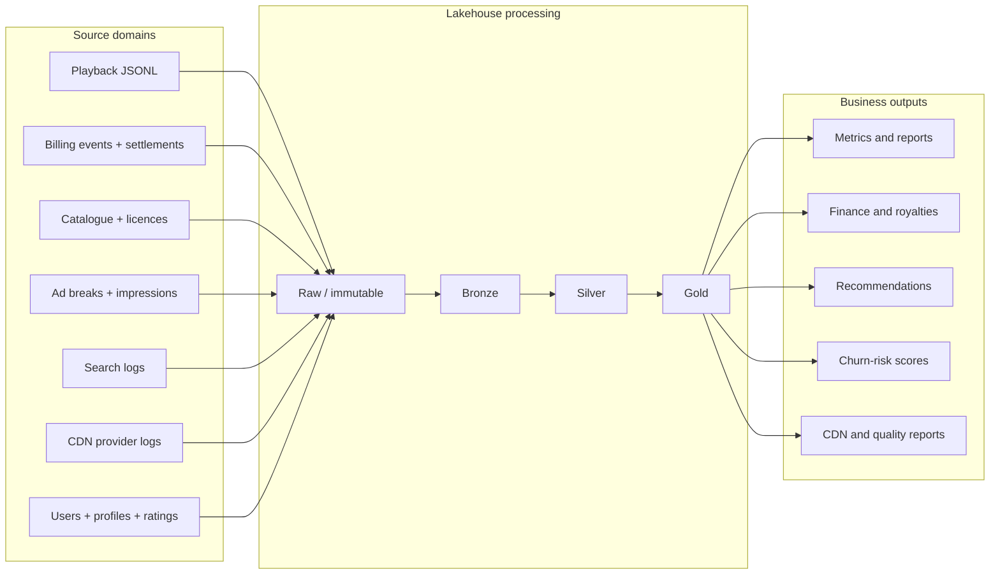

# StreamBharat — OTT Streaming Data Platform

[](https://github.com/Er-Ishan-Srivastav/StreamBharat/actions/workflows/tests.yml)


**A six-member, end-to-end data engineering project for a fictional Indian OTT platform.**

StreamBharat brings together playback, subscriptions, catalogue, search, advertising and CDN data to build a lakehouse-style analytics platform. This repository contains 20 question-specific implementations, a finite batch orchestrator, two separate file-based streaming jobs, deterministic business-rule tests and project documentation.

> **Assignment scope:** Project 4 / Workbook 2 — *StreamBharat: OTT Streaming Analytics Platform*. The course-provided simulator writes JSON files for Spark Structured Streaming. Kafka, Airflow, PostgreSQL and Metabase are not prerequisites for this workbook's core implementation.

## Contents

- [Business problem](#business-problem)
- [Platform at a glance](#platform-at-a-glance)
- [Architecture](#architecture)
- [Workstreams and ownership](#workstreams-and-ownership)
- [Technology stack](#technology-stack)
- [Repository layout](#repository-layout)
- [Dataset setup](#dataset-setup)
- [Run the project](#run-the-project)
- [Testing and validation](#testing-and-validation)
- [Current implementation status](#current-implementation-status)
- [Known limitations and next milestones](#known-limitations-and-next-milestones)
- [Documentation](#documentation)

## Business problem

An OTT platform generates operational data across multiple domains:

| Domain | Data challenge | Analytics outcome |
|---|---|---|
| Playback and engagement | Duplicate events, inaccurate device clocks, offline uploads, session boundaries | Clean playback, watch-time facts, DAU/WAU/MAU |
| Catalogue and discovery | Nested metadata, episodes, languages, genres, regional licensing | Content dimensions, search gaps, regional Top 10, recommendations |
| Subscriptions and finance | Retries, pauses, renewals, cohort movement and settlement differences | Subscription periods, retention, MRR bridge and royalties |
| Advertising | Break fill, impression delivery, completion, frequency caps and pacing | Delivery/revenue reporting, credit-backs and live pacing |
| CDN and platform operations | Multiple provider formats, regional usage and hot keys | Standardised CDN usage, delivery cost and Spark performance comparison |
| Growth and retention | Sparse implicit feedback and future churn risk | ALS recommendations and churn-risk prioritisation |

The fictional business scenario describes a large Indian OTT service. The supplied learning dataset is a much smaller synthetic sample: **2,500 user accounts, 4,736 profiles and approximately 1.62 million playback events**. These are different scales and should not be conflated.

### Dataset-specific conventions

- Playback files are partitioned by **server-arrival date**, not necessarily viewing date.
- The sample heartbeat represents **up to five minutes** of watch time; do not assume a 30-second heartbeat.
- Device client timestamps can be unreliable. Offline events may arrive days after viewing.
- Series episodes have their own content IDs and need parent-series roll-up for some rankings.
- Raw data is supplied separately and is intentionally not committed to this repository.

## Platform at a glance

The platform has two processing paths: a finite batch/lakehouse path and two independent long-running streaming demonstrations.



**Live path:** the supplied simulator emits play and ad-impression JSON files. Q17 consumes play events to calculate trending; Q18 consumes ad impressions to calculate live frequency caps and spend pacing. Each stream has its own checkpoint and output.

## Architecture

The detailed design, contracts, execution boundaries and operational principles are in **[docs/architecture.md](docs/architecture.md)**.

### Medallion responsibilities

| Layer | Responsibility | Example outputs |
|---|---|---|
| Raw | Immutable course files and simulator arrivals | data/raw/**, data/stream/plays/**, data/stream/ads/** |
| Bronze | Source-shaped, traceable ingestion with stable event keys | data/delta/bronze/playback, CDN request records |
| Silver | Typed, deduplicated, corrected and conformed data | playback_clean, cdn_usage_hourly, search_clean |
| Gold | Business-level facts, aggregates and model outputs | Sessions, active users, MRR, royalties, rankings, recommendations, churn scores |
| Quality | Assertions, exceptions and reconciliation results across layers | data/delta/quality/** |

### Processing patterns

- **Incremental ingestion:** Q4 uses a file source, a stable Structured Streaming checkpoint, availableNow and a Delta upsert keyed by event_id.
- **Batch engineering:** Q1–Q16 and Q19–Q20 build dimensions, facts, reports and ML outputs.
- **Event-time streaming:** Q17/Q18 run separately using the course simulator and dedicated checkpoints.
- **Machine learning:** Q16 uses implicit-feedback ALS; Q20 uses a leakage-aware chronological churn evaluation with Spark MLlib Logistic Regression.
- **Orchestration:** src/streambharat/pipeline.py defines the finite batch sequence. It does not launch Q17/Q18.

## Workstreams and ownership

| Owner | Questions | Focus |
|---|---|---|
| Harshvardhan | Q1, Q8, Q10, Q16 | Catalogue modelling, SCD Type 2, rankings, recommendations |
| Rutik | Q2, Q5, Q12, Q14 | Playback clock correction, sessions, account sharing, skew optimisation |
| Kshitij Jaisawal | Q6, Q11, Q15, Q18 | Subscriptions, cohorts/MRR, royalties, live ad pacing |
| Siddhi | Q3, Q7 | CDN log processing, search analytics |
| Ankita | Q9, Q13, Q19 | Engagement metrics, ad delivery, data quality and kids safety |
| Ishan | Q4, Q17, Q20 | Incremental ingestion, real-time trending, churn model and integration |

See [the complete question register](docs/questions-and-ownership.md) and [implementation notes for every workstream](docs/team-workstreams.md) for detailed scope, inputs, outputs, business rules and ownership.

## Technology stack

| Component | Version / role |
|---|---|
| Python | 3.10 or 3.11 |
| Java | 17 runtime for Spark |
| PySpark | 3.5.3 |
| Delta Lake | 3.2.0 |
| Spark MLlib | ALS recommendations and churn classification |
| Spark Structured Streaming | Incremental ingestion and simulator-driven live jobs |
| pytest | Deterministic business-rule tests |
| GitHub Actions | Python tests and compilation checks |

This is a workbook-aligned stack. The repo does not claim a Kafka-based architecture or a deployed BI serving layer.

## Repository layout

```text
StreamBharat/
├── README.md
├── pyproject.toml
├── requirements.txt
├── ott_stream_simulator.py
├── data/
│   └── README.md
├── docs/
│   ├── project-brief.md
│   ├── architecture.md
│   ├── data-catalog.md
│   ├── questions-and-ownership.md
│   ├── team-workstreams.md
│   ├── delivery-plan.md
│   ├── implementation/
│   └── source-materials/
├── src/streambharat/
│   ├── q1_catalog.py ... q20_churn.py
│   ├── pipeline.py
│   ├── quality_rules.py
│   └── spark_session.py
├── tests/
├── scripts/
└── .github/workflows/
```

## Dataset setup

1. Obtain StreamBharat_dataset.zip from the course distribution.
2. Extract it and copy the supplied data/ directory into the repository root.
3. Confirm that these paths exist:

```text
data/raw/player/
data/raw/billing/subscription_events.json
data/raw/billing/gateway_settlements.csv
data/raw/app/users.json
data/raw/app/profiles.json
data/raw/content/catalog_2026-10-01.json
data/raw/ads/
data/raw/cdn/
data/raw/reference/
```

The raw files are excluded from .gitignore. Keep the supplied source data unchanged. For the simulator, run commands from the repository root because it reads catalogue and campaign files using repository-relative paths.

More detail: [data placement](data/README.md) · [dataset inventory and field conventions](docs/data-catalog.md) · [course dataset guide](docs/source-materials/StreamBharat-Dataset-README.md).

## Run the project

### 1. Environment

Use Python 3.10/3.11 and JDK 17. Set JAVA_HOME to the JDK installation.

**Linux / macOS / Git Bash**

```bash
python -m venv .venv
source .venv/bin/activate
python -m pip install --upgrade pip
python -m pip install -e ".[test]"
```

**Windows PowerShell**

```powershell
py -3.11 -m venv .venv
.\.venv\Scripts\Activate.ps1
python -m pip install --upgrade pip
python -m pip install -e ".[test]"
```

The first Spark start may need internet access to resolve the Delta Lake Maven package.

### 2. Inspect the execution plan

```bash
python -m streambharat.pipeline --list
python -m streambharat.pipeline --dry-run
```

The finite sequence includes Q1–Q16, Q19 and Q20. A dry-run checks the stage plan; it does **not** execute Spark transformations.

### 3. Run batch processing

After placing the dataset and confirming upstream outputs are available:

```bash
python -m streambharat.pipeline --as-of 2026-10-31
```

Run a selected sequence:

```bash
python -m streambharat.pipeline --only Q1,Q2,Q4,Q5,Q6
python -m streambharat.pipeline --skip Q14,Q16
```

Selected stages assume their upstream inputs already exist. Review [the cross-team data contracts](docs/delivery-plan.md) before running an isolated question.

### 4. Run live Q17 — trending

**Terminal A — simulator**

```bash
python ott_stream_simulator.py --stream plays
```

**Terminal B — Spark stream**

```bash
python -m streambharat.q17_trending --as-of 2026-11-02
```

### 5. Run live Q18 — ad frequency caps and pacing

**Terminal A — simulator**

```bash
python ott_stream_simulator.py --stream ads
```

**Terminal B — Spark stream**

```bash
python -m streambharat.q18_live_ad_pacing
```

Stop the simulator and stream with Ctrl+C after the demonstration. The simulator writes JSON files under data/stream/plays/ and data/stream/ads/.

### 6. Run tests

```bash
pytest -q
python -m compileall -q src/streambharat tests
```

Pure-Python tests validate deterministic business rules. They do not replace a full Spark/Delta integration run on the course dataset.

## Testing and validation

The CI workflow currently checks the deterministic test suite and Python compilation. The batch orchestrator's dry-run can also be used to inspect the planned stage sequence.

| Validation level | What it establishes | What it does not establish |
|---|---|---|
| Unit tests | Pure business rules behave as expected for test cases | Spark query correctness on full data |
| Python compilation | Modules are syntactically compilable | Runtime dependency or schema compatibility |
| Pipeline dry-run | The finite stage list and ordering can be displayed | That each stage completes or its inputs exist |
| Spark/Delta integration | Actual transformations, checkpoints, Delta writes and outputs | Production-scale reliability unless load-tested |
| Reconciliation/model evaluation | Business totals and model metrics are measured | Generalisation beyond the supplied synthetic sample |

## Current implementation status

**Code coverage:** all 20 question modules are present, with a finite batch orchestrator and separate Q17/Q18 streaming entry points.

**Automated checks:** the latest repository CI workflow passed the deterministic test suite and code checks. See [GitHub Actions](https://github.com/Er-Ishan-Srivastav/StreamBharat/actions).

**Runtime status:** full Spark/Delta integration, complete dataset reconciliation, streaming restart/late-event tests and measured ML metrics remain outstanding. No model AUC, job duration or throughput result is fabricated in this README.

Treat a question as validated only after its Spark job has run against the supplied data, output schemas and key counts have been inspected, business reconciliations have passed, and the owner has walked through the implementation.

## Known limitations and next milestones

1. **Runtime proof:** execute all batch jobs using the pinned Java/PySpark/Delta versions and preserve logs, row counts and output schemas.
2. **Streaming proof:** demonstrate restart from checkpoint, duplicate handling and late-arrival behaviour for Q17/Q18.
3. **Integration proof:** validate Silver/Gold contracts across all six owners and run the complete dependency graph.
4. **Performance evidence:** capture baseline versus AQE/salting timings and record cluster/runtime configuration.
5. **ML evidence:** publish the Q16 precision@10 baseline comparison and Q20 ROC-AUC/PR-AUC from actual chronological holdouts.
6. **Operationalisation:** add a serving layer/dashboard and scheduled deployment only if the project scope is extended beyond the workbook.

## Documentation

- [Project brief](docs/project-brief.md)
- [Architecture and Mermaid diagrams](docs/architecture.md)
- [Question register and team ownership](docs/questions-and-ownership.md)
- [Detailed implementation notes for all 20 questions](docs/team-workstreams.md)
- [Dataset catalogue](docs/data-catalog.md)
- [Data contracts, dependencies and release checklist](docs/delivery-plan.md)
- [Q4 incremental ingestion design](docs/implementation/q4-incremental-ingestion.md)
- [Q17 real-time trending design](docs/implementation/q17-real-time-trending.md)
- [Q20 churn design](docs/implementation/q20-churn-model.md)
- [Student-facing workbook](docs/source-materials/Project-4-StreamBharat-PySpark-Workbook.pdf)
- [Team implementation guide](docs/source-materials/StreamBharat-Team-Distribution-and-Implementation-Guide.pdf)

## Data integrity

All users, profiles, titles, advertisers and other entities in the supplied sample are synthetic. Instructor-only answer/seed notes and data-generation scripts are intentionally excluded. Raw source data and generated stream files remain local and untracked.
