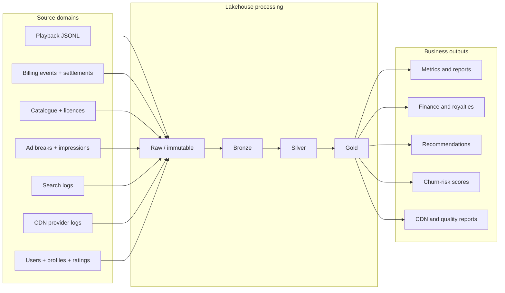

# StreamBharat — OTT Streaming Data Platform

[](https://github.com/Er-Ishan-Srivastav/StreamBharat/actions/workflows/tests.yml)


**A six-member, end-to-end data engineering project for a fictional Indian OTT platform, extended with a local Kafka + Spark streaming path and a Postgres/Metabase serving foundation.**

StreamBharat brings together playback, subscriptions, catalogue, search, advertising and CDN data to build a lakehouse-style analytics platform. This repository contains 20 question-specific implementations, a finite batch orchestrator, two separate file-based streaming jobs, deterministic business-rule tests and project documentation.

> **Scope:** The original PySpark workbook remains the batch-processing baseline. The Kafka ETL workbook adds a second implementation track: seven source topics, two live topics, Bronze Delta ingestion, a Postgres warehouse and Metabase. The local Kafka extension is under active implementation; see the implementation status notes before treating it as fully validated.

## Contents

- [Business problem](#business-problem)
- [Platform at a glance](#platform-at-a-glance)
- [Architecture](#architecture)
- [Workstreams and ownership](#workstreams-and-ownership)
- [Technology stack](#technology-stack)
- [Repository layout](#repository-layout)
- [Dataset setup](#dataset-setup)
- [Run the project](#run-the-project)
- [Testing and validation](#testing-and-validation)
- [Current implementation status](#current-implementation-status)
- [Known limitations and next milestones](#known-limitations-and-next-milestones)
- [Documentation](#documentation)

## Business problem

An OTT platform generates operational data across multiple domains:

| Domain | Data challenge | Analytics outcome |
|---|---|---|
| Playback and engagement | Duplicate events, inaccurate device clocks, offline uploads, session boundaries | Clean playback, watch-time facts, DAU/WAU/MAU |
| Catalogue and discovery | Nested metadata, episodes, languages, genres, regional licensing | Content dimensions, search gaps, regional Top 10, recommendations |
| Subscriptions and finance | Retries, pauses, renewals, cohort movement and settlement differences | Subscription periods, retention, MRR bridge and royalties |
| Advertising | Break fill, impression delivery, completion, frequency caps and pacing | Delivery/revenue reporting, credit-backs and live pacing |
| CDN and platform operations | Multiple provider formats, regional usage and hot keys | Standardised CDN usage, delivery cost and Spark performance comparison |
| Growth and retention | Sparse implicit feedback and future churn risk | ALS recommendations and churn-risk prioritisation |

The fictional business scenario describes a large Indian OTT service. The supplied learning dataset is a much smaller synthetic sample: **2,500 user accounts, 4,736 profiles and approximately 1.62 million playback events**. These are different scales and should not be conflated.

### Dataset-specific conventions

- Playback files are partitioned by **server-arrival date**, not necessarily viewing date.
- The sample heartbeat represents **up to five minutes** of watch time; do not assume a 30-second heartbeat.
- Device client timestamps can be unreliable. Offline events may arrive days after viewing.
- Series episodes have their own content IDs and need parent-series roll-up for some rankings.
- Raw data is supplied separately and is intentionally not committed to this repository.

## Platform at a glance

The platform combines a finite batch/lakehouse path, two simulator-driven streaming jobs and a Kafka-based event path. The original file-source jobs remain available as a baseline.



**Live path:** the supplied simulator emits play and ad-impression JSON files. Q17 consumes play events to calculate trending; Q18 consumes ad impressions to calculate live frequency caps and spend pacing. Each stream has its own checkpoint and output.

**Kafka extension:** local Kafka topics follow the ETL workbook contract: seven source topics, `ott.live.plays`, `ott.live.ads`, a DLQ, metrics/alert outputs and a compacted subscription-state topic. `streambharat.replay_kafka` replays the seven raw source feeds in timestamp order; `streambharat.bronze_ingest` writes append-only Bronze Delta tables. The live simulator bridge publishes to the two `ott.live.*` topics. See [Kafka integration guide](docs/implementation/kafka-streaming.md).

## Architecture

The detailed design, contracts, execution boundaries and operational principles are in **[docs/architecture.md](docs/architecture.md)**.

### Medallion responsibilities

| Layer | Responsibility | Example outputs |
|---|---|---|
| Raw | Immutable course files and simulator arrivals | data/raw/**, data/stream/plays/**, data/stream/ads/** |
| Bronze | Source-shaped, traceable ingestion with stable event keys | data/delta/bronze/playback, CDN request records |
| Silver | Typed, deduplicated, corrected and conformed data | playback_clean, cdn_usage_hourly, search_clean |
| Gold | Business-level facts, aggregates and model outputs | Sessions, active users, MRR, royalties, rankings, recommendations, churn scores |
| Quality | Assertions, exceptions and reconciliation results across layers | data/delta/quality/** |

### Processing patterns

- **Incremental ingestion:** Q4 uses a file source, a stable Structured Streaming checkpoint, availableNow and a Delta upsert keyed by event_id.
- **Batch engineering:** Q1–Q16 and Q19–Q20 build dimensions, facts, reports and ML outputs.
- **Event-time streaming:** Q17/Q18 run separately using the course simulator and dedicated checkpoints.
- **Machine learning:** Q16 uses implicit-feedback ALS; Q20 uses a leakage-aware chronological churn evaluation with Spark MLlib Logistic Regression.
- **Orchestration:** src/streambharat/pipeline.py defines the finite batch sequence. It does not launch Q17/Q18.

## Workstreams and ownership

| Owner | Questions | Focus |
|---|---|---|
| Harshvardhan | Q1, Q8, Q10, Q16 | Catalogue modelling, SCD Type 2, rankings, recommendations |
| Rutik | Q2, Q5, Q12, Q14 | Playback clock correction, sessions, account sharing, skew optimisation |
| Kshitij Jaisawal | Q6, Q11, Q15, Q18 | Subscriptions, cohorts/MRR, royalties, live ad pacing |
| Siddhi | Q3, Q7 | CDN log processing, search analytics |
| Ankita | Q9, Q13, Q19 | Engagement metrics, ad delivery, data quality and kids safety |
| Ishan | Q4, Q17, Q20 | Incremental ingestion, real-time trending, churn model and integration |

See [the complete question register](docs/questions-and-ownership.md) and [implementation notes for every workstream](docs/team-workstreams.md) for detailed scope, inputs, outputs, business rules and ownership.

## Technology stack

| Component | Version / role |
|---|---|
| Python | 3.10 or 3.11 |
| Java | 17 runtime for Spark |
| PySpark | 3.5.3 |
| Delta Lake | 3.2.1 |
| Spark MLlib | ALS recommendations and churn classification |
| Spark Structured Streaming | Incremental ingestion and simulator-driven live jobs |
| pytest | Deterministic business-rule tests |
| GitHub Actions | Python tests and compilation checks |

The Kafka extension adds Apache Kafka 3.8 (KRaft), PySpark 3.5.3 with Delta Lake 3.2, PostgreSQL 16, Metabase, a Jupyter workspace and a separate Airflow 2.10.4 stack for local orchestration. Airflow shares the Kafka/Postgres Docker network and runs the implemented replay-to-Gold pipeline in Spark local mode.

## Repository layout

```text
StreamBharat/
├── README.md
├── pyproject.toml
├── requirements.txt
├── ott_stream_simulator.py
├── data/
│   └── README.md
├── docs/
│   ├── project-brief.md
│   ├── architecture.md
│   ├── data-catalog.md
│   ├── questions-and-ownership.md
│   ├── team-workstreams.md
│   ├── delivery-plan.md
│   ├── implementation/
│   └── source-materials/
├── src/streambharat/
│   ├── q1_catalog.py ... q20_churn.py
│   ├── pipeline.py
│   ├── quality_rules.py
│   └── spark_session.py
├── tests/
├── scripts/
└── .github/workflows/
```

## Dataset setup

1. Obtain StreamBharat_dataset.zip from the course distribution.
2. Extract it and copy the supplied data/ directory into the repository root.
3. Confirm that these paths exist:

```text
data/raw/player/
data/raw/billing/subscription_events.json
data/raw/billing/gateway_settlements.csv
data/raw/app/users.json
data/raw/app/profiles.json
data/raw/content/catalog_2026-10-01.json
data/raw/ads/
data/raw/cdn/
data/raw/reference/
```

The raw files are excluded from .gitignore. Keep the supplied source data unchanged. For the simulator, run commands from the repository root because it reads catalogue and campaign files using repository-relative paths.

More detail: [data placement](data/README.md) · [dataset inventory and field conventions](docs/data-catalog.md) · [course dataset guide](docs/source-materials/StreamBharat-Dataset-README.md).

## Run the project

### 1. Environment

Use Python 3.10/3.11 and JDK 17. Set JAVA_HOME to the JDK installation.

**Linux / macOS / Git Bash**

```bash
python -m venv .venv
source .venv/bin/activate
python -m pip install --upgrade pip
python -m pip install -e ".[test]"
```

**Windows PowerShell**

```powershell
py -3.11 -m venv .venv
.\.venv\Scripts\Activate.ps1
python -m pip install --upgrade pip
python -m pip install -e ".[test]"
```

The first Spark start may need internet access to resolve the Delta Lake Maven package.

### 2. Inspect the execution plan

```bash
python -m streambharat.pipeline --list
python -m streambharat.pipeline --dry-run
```

The finite sequence includes Q1–Q16, Q19 and Q20. A dry-run checks the stage plan; it does **not** execute Spark transformations.

### 3. Run batch processing

After placing the dataset and confirming upstream outputs are available:

```bash
python -m streambharat.pipeline --as-of 2026-10-31
```

Run a selected sequence:

```bash
python -m streambharat.pipeline --only Q1,Q2,Q4,Q5,Q6
python -m streambharat.pipeline --skip Q14,Q16
```

Selected stages assume their upstream inputs already exist. Review [the cross-team data contracts](docs/delivery-plan.md) before running an isolated question.

### 4. Run live Q17 — trending

**Terminal A — simulator**

```bash
python ott_stream_simulator.py --stream plays
```

**Terminal B — Spark stream**

```bash
python -m streambharat.q17_trending --as-of 2026-11-02
```

### 5. Run live Q18 — ad frequency caps and pacing

**Terminal A — simulator**

```bash
python ott_stream_simulator.py --stream ads
```

**Terminal B — Spark stream**

```bash
python -m streambharat.q18_live_ad_pacing
```

Stop the simulator and stream with Ctrl+C after the demonstration. The simulator writes JSON files under data/stream/plays/ and data/stream/ads/.

### 6. Run tests

```bash
pytest -q
python -m compileall -q src/streambharat tests
```

Pure-Python tests validate deterministic business rules. They do not replace a full Spark/Delta integration run on the course dataset.

## Testing and validation

The CI workflow currently checks the deterministic test suite and Python compilation. The batch orchestrator's dry-run can also be used to inspect the planned stage sequence.

| Validation level | What it establishes | What it does not establish |
|---|---|---|
| Unit tests | Pure business rules behave as expected for test cases | Spark query correctness on full data |
| Python compilation | Modules are syntactically compilable | Runtime dependency or schema compatibility |
| Pipeline dry-run | The finite stage list and ordering can be displayed | That each stage completes or its inputs exist |
| Spark/Delta integration | Actual transformations, checkpoints, Delta writes and outputs | Production-scale reliability unless load-tested |
| Reconciliation/model evaluation | Business totals and model metrics are measured | Generalisation beyond the supplied synthetic sample |

## Current implementation status

**Code coverage:** all 20 question modules are present, with a finite batch orchestrator and separate Q17/Q18 streaming entry points.

**Automated checks:** GitHub Actions runs the pure-Python and Spark contract tests, followed by Python compilation for the source modules, scripts and Airflow DAGs. See [GitHub Actions](https://github.com/Er-Ishan-Srivastav/StreamBharat/actions).

**Kafka extension status:** the branch now contains seven-source chaos replay (late, duplicate, poison and corrected events), an optional clean replay with a durable source-record acknowledgement ledger, independent Bronze consumers, source DLQ validation/routing and daily DLQ metrics, retained-offset reconciliation, player schema-v1/v2 and clock handling, a restartable July–September arrival-day backfill, master/reference loads and CDN log normalization, subscription SCD2/grace handling, Gold engagement and session analytics, ad-break/impression matching and campaign pacing, revenue/settlement reconciliation, quarterly partner royalties, DQ quarantine/gating, CDN egress cost, published-board variance reconciliation, live Q17/Q18 adapters, streaming throughput/lag/freshness metrics, Postgres JDBC staging/upserts, query-ready Metabase views, and an Airflow full-refresh/date-sliced DAG. The local stack includes Kafka, Spark workspace, Postgres, Metabase and Airflow.

**Runtime status:** the previous completed CI run passed its Spark contract suite and Python compilation. A fresh CI run is executing against the latest branch head. The full Docker/Spark/Kafka/Postgres pipeline has not yet been executed here against the complete course dataset. Metabase still requires its saved questions and dashboards to be assembled after data is loaded. Published-board actuals, throughput numbers and end-to-end reconciliation are not claimed.

Treat a question as validated only after its Spark job has run against the supplied data, output schemas and key counts have been inspected, business reconciliations have passed, and the owner has walked through the implementation.

## Remaining validation and delivery work

1. **Clean local deployment:** run the Compose stack, create all thirteen topics and execute the complete Airflow DAG on the supplied dataset.
2. **Business reconciliation:** inspect source-to-Bronze offsets, July–September late arrival counts, DQ exceptions, finance/royalty totals and variance against `published_metrics.csv`.
3. **Streaming failure drills:** demonstrate checkpoint restart, replay deduplication, late-event behaviour, broker outage and alert retry semantics.
4. **BI completion:** connect Metabase, save the committed SQL cards and assemble the three dashboard collections using populated Postgres data.
5. **Performance evidence:** capture Spark job durations, input/processed rates, batch duration, lag and freshness. Do not invent throughput or model metrics.
6. **AWS:** intentionally deferred until local validation and BI sign-off are complete.


## Initialize the local Kafka platform

The Kafka ETL implementation is integrated into this repository under
`src/streambharat/`; the supplied starter ZIP is the reference scaffold, not a
second project that needs to be copied into a nested folder.

From the repository root, run:

```bash
cp .env.example .env
# Review local-only credentials, then:
bash scripts/start_local_stack.sh
```

The script builds and starts Kafka, a Spark 3.5.3 standalone
master/worker cluster, the PySpark/Jupyter workspace, PostgreSQL, Metabase and
Airflow, then creates and verifies all 13 Kafka topics. It runs a connectivity
smoke test across Kafka, Spark, Delta and Postgres. Dataset preflight runs
automatically if `data/raw/` exists; otherwise initialization still completes
and data preflight is deferred until you copy the supplied dataset into that
directory.

| Local service | Address |
|---|---|
| Kafka UI | http://localhost:8080 |
| Spark master UI | http://localhost:8082 |
| Spark worker UI | http://localhost:8083 |
| Spark application UI | http://localhost:4040 |
| JupyterLab | http://localhost:8888 |
| Metabase | http://localhost:3000 |
| Airflow | http://localhost:8081 |
| PostgreSQL | localhost:5432, database `ottdw` |

The workspace uses the standalone Spark master by default. Spark applications
launched by Airflow run in local mode inside the Airflow task container; the
interactive workspace uses the Spark worker cluster.

After the dataset is present, the first historical Airflow run is triggered by:

```bash
bash scripts/trigger_local_full_run.sh 2026-10-01 2026-10-31
```

The project uses the supplied workbook's topic names and partition counts.
The Airflow historical replay uses the workbook producer engine: it emits the
Android 7.3 schema-v2 change from 15 October 2026, plus controlled late,
duplicate and poisoned messages, then sends corrected versions. The optional
clean replay module `python -m streambharat.replay_kafka` uses a durable
acknowledgement ledger under `lake/state/`; downstream Silver MERGE/dedup
remains the business-level replay protection for Kafka messages.

### Real-time sessions and ad delivery (Q9/Q10)

Start these Spark consumers before the Airflow historical replay if you want
to process the full source history from Kafka:

```bash
# Session windows: 30-minute inactivity gap, 12-minute event-time watermark
docker compose -f docker-compose.kafka.yml exec workspace \
  bash scripts/run_session_stream.sh --starting-offsets earliest

# Ad break/impression stream-stream join, 45-minute watermark
docker compose -f docker-compose.kafka.yml exec workspace \
  bash scripts/run_ad_matching_stream.sh --starting-offsets earliest
```

They write Delta facts to `lake/silver/viewing_sessions_stream`,
`lake/silver/ad_delivery_stream` and
`lake/silver/orphan_impressions_stream`. The Postgres serving job exposes
these as `ottdw.v_viewing_sessions_stream`, `ottdw.v_ad_delivery_stream`
and `ottdw.v_orphan_impressions_stream` for Metabase.

### Optional manual Kafka replay and live streams

For a small clean replay smoke test (with a durable source-record ledger):

```bash
docker compose -f docker-compose.kafka.yml exec workspace \
  python -m streambharat.replay_kafka --start-date 2026-10-01 \
  --end-date 2026-10-31 --speed 0 --max-events 1000
```

The full Airflow DAG instead calls `producers/replay.py` with controlled
late, duplicate and poisoned source messages. To run that producer manually:

```bash
docker compose -f docker-compose.kafka.yml exec workspace \
  python producers/replay.py --from 2026-10-01 --to 2026-10-31 --speed 0
```

Pass `--no-chaos` for a clean source feed. The source replay uses an
idempotent Kafka producer; re-running it can create new Kafka offsets, so
downstream business-key MERGE/dedup is required.

For live Q14/Q15, start the producer and Spark consumer in separate terminals:

```bash
# Terminal A: live event source
docker compose -f docker-compose.kafka.yml exec workspace \
  python producers/live.py --stream both --seconds 900

# Terminal B: Spark Structured Streaming consumer (plays or ads)
docker compose -f docker-compose.kafka.yml exec workspace \
  bash scripts/run_kafka_stream.sh plays
```

Use `ads` instead of `plays` to run the ad-pacing stream. Do not launch the
same stream twice with the same checkpoint.

## Documentation

- [Project brief](docs/project-brief.md)
- [Architecture and Mermaid diagrams](docs/architecture.md)
- [Question register and team ownership](docs/questions-and-ownership.md)
- [Detailed implementation notes for all 20 questions](docs/team-workstreams.md)
- [Dataset catalogue](docs/data-catalog.md)
- [Data contracts, dependencies and release checklist](docs/delivery-plan.md)
- [Q4 incremental ingestion design](docs/implementation/q4-incremental-ingestion.md)
- [Q17 real-time trending design](docs/implementation/q17-real-time-trending.md)
- [Q20 churn design](docs/implementation/q20-churn-model.md)
- [Kafka ETL pipeline and local deployment guide](docs/implementation/kafka-streaming.md)
- [Metabase dashboard and SQL card guide](docs/dashboards.md)
- [Local Airflow DAG and backfill instructions](dags/README.md)
- [AWS deployment plan (deferred)](docs/aws-deployment-plan.md)
- [Student-facing workbook](docs/source-materials/Project-4-StreamBharat-PySpark-Workbook.pdf)
- [Team implementation guide](docs/source-materials/StreamBharat-Team-Distribution-and-Implementation-Guide.pdf)

## Data integrity

All users, profiles, titles, advertisers and other entities in the supplied sample are synthetic. Instructor-only answer/seed notes and data-generation scripts are intentionally excluded. Raw source data and generated stream files remain local and untracked.


## Local Kafka + Spark runtime

The local-first runtime is a single-node development stack (Kafka in KRaft mode,
a Spark/PySpark workspace, Postgres and Metabase). It is not a production cluster.
Copy `.env.example` to `.env` and change the local-only credentials.
Place the supplied dataset at `data/raw/` without changing raw files.

```bash
bash scripts/start_local_stack.sh
docker compose -f docker-compose.kafka.yml exec workspace pytest -q
bash config/kafka-topics.sh
```

Open Kafka UI at `http://localhost:8080`, JupyterLab at
`http://localhost:8888` (development token: `streambharat-local`)
and Metabase at `http://localhost:3000`. The Postgres warehouse is
`localhost:5432/ottdw` (`ott` / `ott_local_dev`).
These credentials are for local development only.

Create the workbook's thirteen topics from the repository root with
`bash config/kafka-topics.sh`. The seven source topics and
the two live topics are distinct. The current simulator bridge feeds only
`ott.live.plays` and `ott.live.ads`:

```bash
docker compose -f docker-compose.kafka.yml exec workspace \
  python -m streambharat.kafka_producer --stream both
```


Replay the seven October source feeds into the workbook-defined topics (run this after Kafka is healthy and topics have been created):

```bash
docker compose -f docker-compose.kafka.yml exec workspace \
  python -m streambharat.replay_kafka --start-date 2026-10-01 --end-date 2026-10-31 --speed 0
```

For a small replay smoke test, add `--max-events 2000`. The replay reads from `data/raw/` and does not edit source files. Start the Bronze consumer before replay for continuous ingestion; for a completed replay, run the consumer afterward with `--available-now`.

Start the seven Kafka-to-Delta Bronze consumers with:

```bash
docker compose -f docker-compose.kafka.yml exec workspace \
  bash scripts/run_bronze_ingest.sh --available-now
```

Run the DLQ validator independently. It stores invalid source records in
`lake/bronze/dlq` and publishes them to `ott.dlq`:

```bash
docker compose -f docker-compose.kafka.yml exec workspace \
  bash scripts/run_dlq_ingest.sh --available-now
```

The Bronze and DLQ queries use independent checkpoints. For a full replay,
run both after the source replay has completed; for continuous ingestion,
start both in processing mode before the replay starts.

### 7. Run the Airflow DAG

Start the Kafka compose stack first; this creates the shared Docker network. Then start
the Airflow stack:

```bash
docker compose -f docker-compose.airflow.yml up -d --build
```

Open Airflow at `http://localhost:8081` (local development login: `admin` /
`admin_local_dev`). For the first complete local run, trigger the DAG with the one-command helper:

```bash
bash scripts/trigger_local_full_run.sh 2026-10-01 2026-10-31
```

This sets `full_refresh=true`, replays October source files, runs the July–September
arrival-day backfill, rebuilds all date-partitioned engagement/session/ad Gold,
and loads the available Delta outputs into Postgres. For a single-day rerun,
use Airflow configuration with `date`, `start_date` and `end_date` set to the
same day. See [Airflow runbook](dags/README.md) for details.

The batch replay acknowledgement ledger is `lake/state/kafka_replay.sqlite3`;
keep it across normal reruns so acknowledged file/line records are skipped.
The crash window between Kafka delivery acknowledgement and the SQLite ledger
commit remains at-least-once. See the [Kafka implementation guide](docs/implementation/kafka-streaming.md).


Use `--available-now` for bounded replay/backfill consumption. Omit it for
long-running processing-time ingestion. The Spark Kafka connector is fetched by
`spark-submit` when first used; a working Maven repository connection is needed.
For live trending and ad pacing, start the corresponding Spark jobs using
`scripts/run_kafka_stream.sh plays` or
`scripts/run_kafka_stream.sh ads` and run
`python ott_stream_simulator.py --stream both` in another workspace terminal.
