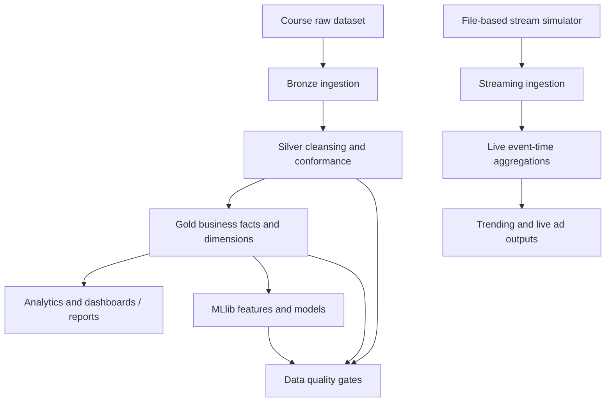

# Architecture and processing design

## Logical data flow

## Lakehouse zones

### Raw / source

Course-provided files under `data/raw/` are immutable source inputs. The Q17/Q18 simulator writes JSON files under `data/stream/plays/` or `data/stream/ads/`.

### Bronze

Bronze preserves the source event shape, adds ingestion lineage and protects against replay duplicates. Ishan's Q4 module writes playback Delta to `data/delta/bronze/playback/` with a dedicated checkpoint under `data/checkpoints/q4_playback/`.

### Silver

Silver is where team modules should enforce business-ready types, deduplicate records, correct timestamps, standardise keys and quarantine invalid records. Rutik's Q2 `playback_clean` is the preferred playback source for Q5, Q9–Q12, Q14 and Q20.

### Gold

Gold contains business-level outputs such as watch-time facts, subscription snapshots, active-user metrics, rankings, finance/royalty measures, advertising measures, CDN cost, recommendations, churn-risk results and quality reports.

## Workload patterns

- **Incremental file ingestion (Q4):** Spark Structured Streaming file source, explicit schema, `availableNow`, stable checkpoint and Delta `MERGE` keyed by `event_id`.
- **Batch transformations (Q1–Q16, Q19–Q20):** Spark DataFrames/SQL with repeatable Delta inputs and outputs.
- **Live event-time streaming (Q17–Q18):** file source driven by the supplied simulator, separate checkpoint directories and event-time logic.
- **Machine learning (Q16, Q20):** Spark MLlib training/evaluation and versioned output artefacts.

## Technical baseline

- Python 3.10 or 3.11
- Java 17
- PySpark 3.5.3
- Delta Lake 3.2.0
- pytest 8+
- Spark master defaults to local mode for course/lab execution; use a shared cluster configuration only when the team agrees on it.

## Operational principles

1. Never mutate raw files.
2. Give each streaming query its own stable checkpoint directory.
3. Persist schemas/contracts for cross-member tables.
4. Use small DataFrames for logic tests before full dataset runs.
5. Make writes restartable and idempotent where replay is possible.
6. Keep model feature timestamps strictly before the prediction anchor.
7. Record row counts, null rates, duplicate rates and key business reconciliations at each stage.
8. Treat a question as complete only after code execution, output inspection, validation and owner walkthrough.
