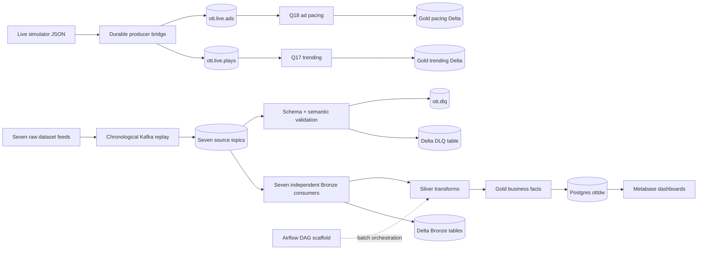

# Kafka ETL platform — StreamBharat

## Scope and topic contracts

This extension follows the Kafka ETL workbook rather than the original PySpark workbook's
question numbering. It separates the seven historical/source feeds from the two live feeds.

| Alias | Kafka topic | Partitions | Key |
|---|---|---:|---|
| player_events | ott.player.events | 6 | user_id |
| billing_subscr | ott.billing.subscr | 3 | user_id |
| billing_settle | ott.billing.settle | 3 | user_id |
| app_search | ott.app.search | 3 | profile_id |
| app_ratings | ott.app.ratings | 1 | profile_id |
| ads_breaks | ott.ads.breaks | 3 | user_id |
| ads_impressions | ott.ads.impressions | 3 | user_id |
| Live plays | ott.live.plays | 6 | user_id |
| Live ads | ott.live.ads | 6 | user_id |
| DLQ | ott.dlq | 3 | source topic/partition/offset |
| Trending output | ott.metrics.trending | 3 | content/window/language |
| Pacing alerts | ott.alerts.ad_pacing | 3 | alert identifier |
| Subscription state | ott.ref.subscription_state | 3 | user_id (compacted) |

The source topic partition counts and keys are taken from the uploaded Kafka ETL workbook.
The seven source topics carry the batch dataset feeds. The two live topics are driven by
the supplied simulator bridge; they are not substitutes for the seven source streams.

## Architecture



## Local stack

The development stack includes Kafka 3.8 KRaft, Kafka UI, Postgres 16, Metabase and a
Python 3.11 workspace with Java 17, PySpark 3.5.3, Delta Lake 3.2, JupyterLab and
the Confluent Kafka client. Spark runs in local mode inside the workspace container;
there is not yet a separate Spark master/worker cluster. The stack uses one broker,
PLAINTEXT listeners and replication factor 1 and is not production-secure.

From the repository root:

```bash
docker compose -f docker-compose.kafka.yml up -d --build
bash config/kafka-topics.sh
docker compose -f docker-compose.kafka.yml exec workspace pytest -q
```

Services:
- Kafka UI: http://localhost:8080
- JupyterLab: http://localhost:8888 (local token: streambharat-local)
- Metabase: http://localhost:3000
- Postgres warehouse: localhost:5432, database ottdw

The local credentials are for development only. The supplied dataset remains external to
Git and must be copied to data/raw/ as described in docs/source-materials/StreamBharat-Dataset-README.md.

## Seven-source replay and Bronze

Start by replaying the October 2026 raw dataset. The replay uses source-specific timestamp
fields, the correct key per topic, and orders events across the seven feeds. Playback files
are named by server-arrival day. Ad impressions are scheduled at ad-break time plus
duration, because the source contract says the event is sent when the ad finishes.

```bash
docker compose -f docker-compose.kafka.yml exec workspace \
  python -m streambharat.replay_kafka --start-date 2026-10-01 --end-date 2026-10-31 --speed 0
```

For a small check, append --max-events 2000. A speed of zero disables simulated-time delay;
a speed of one replays one simulated day per real minute.

Bronze ingestion starts one Structured Streaming query per source topic, preserves the raw
value and Kafka metadata (topic, partition, offset, broker timestamp, key, headers), adds
ingestion timestamp/date, partitions by ingestion date, and stores a separate checkpoint
for each topic under lake/_checkpoints/.

```bash
# Long-running ingestion
docker compose -f docker-compose.kafka.yml exec workspace bash scripts/run_bronze_ingest.sh

# Bounded catch-up after a completed replay
docker compose -f docker-compose.kafka.yml exec workspace bash scripts/run_bronze_ingest.sh --available-now
```

The default starting offset applies only when the checkpoint is first created. Preserve
the checkpoint for ordinary restarts; use a new checkpoint only for a planned replay.
The Kafka connector is resolved as a Spark Maven package and therefore requires access
to the configured Maven repository on first execution.

## Dead-letter validation

Run the seven-source validator after replay, or alongside continuous Bronze ingestion:

```bash
docker compose -f docker-compose.kafka.yml exec workspace \
  bash scripts/run_dlq_ingest.sh --available-now
```

The raw Bronze copy remains unmodified. The validator parses scalar JSON fields, checks
required identifiers and timestamps, normalises neither the input nor its raw payload,
and classifies malformed JSON, missing required fields, invalid numeric values, invalid
ratings, missing player positions and invalid ad durations/flags. Invalid records are
written to lake/bronze/dlq and to ott.dlq. The stable DLQ identifier is source_topic,
partition and offset, so replaying a micro-batch does not add another Delta DLQ row.
Kafka and Delta writes are separate sinks, not one distributed transaction; if a task
fails between the two sinks, the Kafka DLQ key may be published again.

## Silver player starter

Once Bronze player data is available:

```bash
docker compose -f docker-compose.kafka.yml exec workspace \
  python -m streambharat.silver_player --bronze lake/bronze/player_events
```

The current first slice parses both player schema versions, converts position_ms to seconds,
estimates per-device median clock offset for online events, preserves client time for
download/offline events, records event and arrival dates, and MERGEs by event_id. It also
writes malformed or un-timestamped records to a quarantine Delta path. The device clock
offset table is retained for audit.

## Live streams

The file simulator creates complete JSONL files in data/stream/plays and data/stream/ads.
The producer bridge tails these files, keys both topics by user_id, emits event metadata
headers, and records acknowledgements in a local SQLite state database so a normal restart
does not blindly replay every previously acknowledged event.

```bash
# Workspace terminal 1
python ott_stream_simulator.py --stream both

# Workspace terminal 2
python -m streambharat.kafka_producer --stream both

# Workspace terminal 3
bash scripts/run_kafka_stream.sh plays

# Workspace terminal 4
bash scripts/run_kafka_stream.sh ads
```

Each Spark query has its own checkpoint in lake/_checkpoints/kafka_q17 and
lake/_checkpoints/kafka_q18. The current Kafka Q17/Q18 adapter reuses the repository's
existing Delta business logic. The current slice does not yet publish the computed live
trending/pacing results to the output topics; that output sink is the next integration
step and is not described as complete.

## Operational guarantees and constraints

- Producer idempotence protects producer retry semantics within a producer session; it is
  not business-level deduplication.
- The file bridge persists acknowledged event identities in SQLite; this is local state
  and should be included in backups alongside the lake/checkpoints for a local demo.
- Bronze uses an independent checkpoint per topic and append-only Delta output.
- Silver player MERGE uses event_id as its business key.
- DLQ Delta idempotency uses source topic/partition/offset. The Kafka DLQ may still receive
  a repeated key if the separate sinks are retried; consumers should deduplicate by key.
- This project targets at-least-once delivery with idempotent Delta effects. There is no
  claim of end-to-end exactly-once semantics across Kafka and Delta.
- The compose stack is a one-broker local development environment, not production security,
  high availability or multi-node Spark.

## Validation checklist

- [ ] Local Docker stack starts and all thirteen Kafka topics exist with expected partitions.
- [ ] Source replay publishes data to each of the seven source topics.
- [ ] Seven Bronze Delta tables contain raw data with source offsets and headers.
- [ ] Partition-level Bronze offset reconciliation is reviewed.
- [ ] Invalid payloads are visible in both Delta DLQ and the Kafka DLQ topic.
- [ ] Player v1/v2 position values are normalised and device clock offsets are inspected.
- [ ] Duplicate event_id records do not duplicate Silver player rows.
- [ ] Live Q17/Q18 consume the two live topics and update Delta state.
- [ ] Stop/restart each Spark streaming job with the same checkpoint.
- [ ] Capture throughput, batch duration, freshness and lag measurements.
- [ ] Postgres tables contain Gold aggregates and Metabase dashboards query the warehouse.

## Deferred from this implementation slice

The full Kafka workbook still requires the subscription SCD2 state machine and compacted
reference topic, sessionisation, ad-break/impression stream join, batch catalog/licence/user
dimensions, July–September backfill, business Gold metrics, financial reconciliation,
royalty guarantees, robust offset-reconciliation boundaries, trend and pacing Kafka output
topics, Airflow tasks running these exact jobs, and performance/failure-drill evidence.
The files in this branch are foundations and should be runtime-tested with the supplied
dataset before being described as production-ready.
