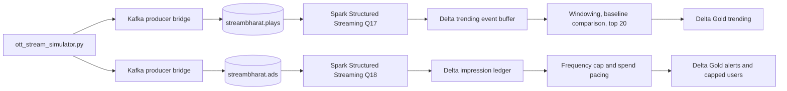

# Kafka integration — StreamBharat

## Objective

Extend the workbook-aligned local platform with Apache Kafka as a durable event transport while preserving the existing PySpark, Spark SQL, Delta Lake and business-rule implementations.

Kafka is an extension to the current project, not a replacement for:
- Q4: incremental batch/file ingestion into Bronze Delta;
- Q17: real-time trending;
- Q18: live ad frequency caps and spend pacing.

The original file-based Q17/Q18 entry points remain available for workbook compatibility and offline demonstrations.

## Architecture



## Topic contracts

### streambharat.plays

Kafka key: `event_id`.

Value is the existing simulator play JSON:
`event_id, user_id, profile_id, content_id, language, event_ts`.

### streambharat.ads

Kafka key: `impression_id`.

Value is the existing simulator ad JSON:
`impression_id, user_id, campaign_id, ad_break_ts, duration_sec, cpm_inr`.

The simulator schema is preserved. No enrichment is added to the event payload at the producer boundary.

## Components

- `docker-compose.kafka.yml`: single-node Kafka KRaft development broker.
- `config/kafka-topics.sh`: creates the two domain topics.
- `src/streambharat/kafka_producer.py`: tails completed simulator JSON files and publishes records with stable keys.
- `src/streambharat/kafka_streams.py`: Spark Kafka source, JSON parsing, and Q17/Q18 delegation.
- `data/checkpoints/kafka_q17/` and `data/checkpoints/kafka_q18/`: independent Spark source checkpoints.
- Existing Delta buffers/ledgers and Gold outputs remain the serving/storage layer.

## Local prerequisites

- Docker Engine / Docker Desktop with Compose.
- Python 3.10 or 3.11, Java 17.
- Existing StreamBharat project dependencies (PySpark 3.5.3 and Delta Lake 3.2.0).
- Kafka Spark connector matching Spark 3.5.3: `org.apache.spark:spark-sql-kafka-0-10_2.12:3.5.3`.
- Python Kafka client: `confluent-kafka`.

The Kafka Spark connector is a JVM package and is not installed by pip. Add it when launching Spark using `--packages`, or configure `spark.jars.packages` in the session builder. The artifact must match the Spark and Scala versions shipped with the Spark distribution.

## Install optional dependency

```bash
pip install "confluent-kafka>=2.3,<3"
```

Kafka is an optional extension. The existing workbook/batch environment should continue to work without importing the Kafka producer at module import time if you move its client import into the runtime entry point.

## Start the broker and topics

```bash
docker compose -f docker-compose.kafka.yml up -d
bash config/kafka-topics.sh
```

Broker endpoint for applications on the same host: `localhost:9092`.

## Run the end-to-end event path

Use separate terminals from the repository root.

**1. Start simulator**

```bash
python ott_stream_simulator.py --stream both
```

The simulator continues writing JSONL files to `data/stream/plays/` and `data/stream/ads/`.

**2. Publish completed files into Kafka**

```bash
python -m streambharat.kafka_producer --stream both
```

The bridge ignores temporary files, uses the event ID as the Kafka key, and tracks published file paths and event IDs within its process. Restarting the bridge clears this in-memory file registry; consumers and Delta sinks must therefore remain idempotent. For a production publisher, store source-file offsets or a durable outbox state rather than relying on an in-memory registry.

**3. Start Spark Q17 consumer**

```bash
spark-submit \
  --packages org.apache.spark:spark-sql-kafka-0-10_2.12:3.5.3 \
  --master local[*] \
  --conf spark.sql.extensions=io.delta.sql.DeltaSparkSessionExtension \
  --conf spark.sql.catalog.spark_catalog=org.apache.spark.sql.delta.catalog.DeltaCatalog \
  -m streambharat.kafka_streams --stream plays
```

**4. Start Spark Q18 consumer in a separate process**

```bash
spark-submit \
  --packages org.apache.spark:spark-sql-kafka-0-10_2.12:3.5.3 \
  --master local[*] \
  --conf spark.sql.extensions=io.delta.sql.DeltaSparkSessionExtension \
  --conf spark.sql.catalog.spark_catalog=org.apache.spark.sql.delta.catalog.DeltaCatalog \
  -m streambharat.kafka_streams --stream ads
```

For module execution, use the equivalent Python command with `PYSPARK_SUBMIT_ARGS` / `spark.jars.packages` configured before the Spark session is created. Verify the actual command against your installed Spark distribution; `spark-submit -m` is not supported by all Spark launchers.

## Important implementation notes / validation gates

1. **Spark connector dependency:** Spark Kafka source requires the matching `spark-sql-kafka-0-10` connector JAR at runtime. The Python package alone is insufficient.
2. **Schema alignment:** Kafka play/ad schema must match the current Q17/Q18 schemas. Confirm actual module names/signatures in the implementation before first run.
3. **Checkpoint identity:** Each topic/query needs a stable, unique checkpoint location. Do not reuse file-source checkpoints for Kafka-source queries.
4. **Replay/idempotence:** Spark Kafka offsets and Delta side effects are not one atomic transaction. Keep Delta merge/ledger keys (`event_id`, `impression_id`) as the idempotency boundary and test a restart during a write.
5. **Delivery guarantee:** Use at-least-once consumption with deduplicating Delta sinks as the first reliable target. Do not claim end-to-end exactly-once without proving offset, foreachBatch and sink transaction behaviour.
6. **Ordering:** Ordering is only guaranteed within a Kafka partition. A stable event key keeps the same entity key on one partition.
7. **Retention:** Set topic retention and partition count for the environment. Three partitions are a local demonstration default, not a benchmark-derived production setting.
8. **Security:** Local PLAINTEXT is for development only. Use SASL_SSL, secrets management, ACLs and restricted network access outside the local lab.
9. **Producer bridge restart:** The current bridge's in-memory dedupe is not durable; after a restart it can republish files. Delta sink idempotence protects results, but production-grade source tracking needs a persistent outbox.
10. **Validation remains pending:** test broker recovery, source restarts, duplicate/replayed events, late event-time updates, checkpoint recovery, DLQ/quarantine, throughput and consumer lag. Record measurements; do not assume they have passed.

## Suggested next phases

- Phase 1: local KRaft Kafka and topic contracts.
- Phase 2: durable producer cursor/outbox and schema versioning.
- Phase 3: Spark Kafka readers for Q17/Q18 and Delta replay tests.
- Phase 4: additional live use cases (near-real-time active viewers, regional playback quality, CDN event alerts) only after validating input event coverage.
- Phase 5: observability (consumer lag, input rows/sec, processing latency, failed records) and containerised deployment.

## References

- Apache Spark Structured Streaming Kafka integration: https://spark.apache.org/docs/3.5.3/structured-streaming-kafka-integration.html
- Confluent Kafka Python client: https://docs.confluent.io/kafka-clients/python/current/overview.html
- Kafka delivery semantics: https://kafka.apache.org/documentation/#semantics
