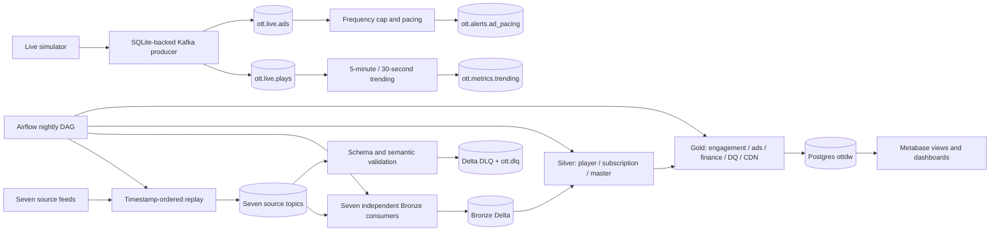

# Kafka ETL platform — StreamBharat

## Scope and topic contracts

This extension implements the separate Kafka ETL workbook alongside the original
PySpark workbook. Original Q1–Q20 modules and their orchestrator remain intact.

| Stream | Topic | Partitions | Key |
|---|---|---:|---|
| Player events | `ott.player.events` | 6 | `user_id` |
| Subscription events | `ott.billing.subscr` | 3 | `user_id` |
| Gateway settlements | `ott.billing.settle` | 3 | `user_id` |
| Search logs | `ott.app.search` | 3 | `profile_id` |
| Ratings | `ott.app.ratings` | 1 | `profile_id` |
| Ad breaks | `ott.ads.breaks` | 3 | `user_id` |
| Ad impressions | `ott.ads.impressions` | 3 | `user_id` |
| Live plays | `ott.live.plays` | 6 | `user_id` |
| Live ad impressions | `ott.live.ads` | 6 | `user_id` |
| Dead-letter queue | `ott.dlq` | 3 | source topic/partition/offset |
| Trending output | `ott.metrics.trending` | 3 | window/language/rank |
| Pacing alerts | `ott.alerts.ad_pacing` | 3 | stable alert identifier |
| Current subscription state | `ott.ref.subscription_state` | 3 | `user_id` (compacted) |

Only `ott.ref.subscription_state` uses Kafka log compaction. Trending and ad
pacing outputs are event/update topics and are not compacted by the local topic
provisioner.

The first seven source feeds are replayed from the raw course dataset. The two live
topics are fed from the supplied simulator through a producer bridge. Live play
events do not replace the historical player events source topic.

## Architecture



## Local runtime

The local stack includes Kafka 3.8 KRaft, Kafka UI, Postgres 16, Metabase, a
Python 3.11 workspace with Java 17, PySpark 3.5.3, Delta Lake 3.2, JupyterLab
and the Confluent Kafka client. Spark runs in local mode inside the workspace
and Airflow containers; a separate Spark master/worker cluster is not configured.
The single broker, PLAINTEXT listeners and replication factor 1 are development
settings, not production security or high availability.

From the repository root:

```bash
docker compose -f docker-compose.kafka.yml up -d --build
docker compose -f docker-compose.kafka.yml exec workspace \
  python scripts/preflight_dataset.py --data-root data/raw
bash config/kafka-topics.sh
docker compose -f docker-compose.kafka.yml exec workspace pytest -q
```

Services:
- Kafka UI: http://localhost:8080
- JupyterLab: http://localhost:8888 (local token: `streambharat-local`)
- Metabase: http://localhost:3000
- Postgres warehouse: localhost:5432, database `ottdw`

The course dataset is not stored in Git. Copy the supplied data folder to
`data/raw/` without editing the source files.

## Source replay, Bronze and DLQ

Replay October source feeds:

```bash
docker compose -f docker-compose.kafka.yml exec workspace \
  python -m streambharat.replay_kafka \
  --start-date 2026-10-01 --end-date 2026-10-31 --speed 0
```

For a small smoke test, add `--max-events 2000`. The replay uses source-specific
event/arrival timestamps and the workbook's key fields. Player files are named
by server-arrival date. Ad impressions are emitted according to their
ad-break/impression timestamps.

A durable SQLite acknowledgement ledger at
`lake/state/kafka_replay.sqlite3` records source topic/file/line, payload hash,
and acknowledged Kafka partition/offset. A normal rerun skips acknowledged
records. If the raw source row changes at the same file/line identity, replay
fails rather than silently publishing a different payload. Keep this state
database with the local lake across normal reruns. The crash window between
Kafka acknowledgement and SQLite commit remains at-least-once; downstream
deduplication by business key is still required. Use a new state DB only when
you intentionally want a full replay of a revised source dataset.

Seven separate Structured Streaming queries write append-only Bronze Delta
tables. Each preserves the raw value string, topic, partition, offset, broker
timestamp, Kafka key, headers, ingestion timestamp and ingestion date. Each
topic has its own checkpoint under `lake/_checkpoints`.

```bash
docker compose -f docker-compose.kafka.yml exec workspace \
  bash scripts/run_bronze_ingest.sh --available-now
docker compose -f docker-compose.kafka.yml exec workspace \
  bash scripts/run_dlq_ingest.sh --available-now
```

The source validator checks identifiers, event timestamps, selected semantic
types, player position schema-v1/schema-v2, subscription amount, ratings and ad
payload constraints. Invalid records are merged to Delta DLQ using the stable
source topic/partition/offset key, then published to `ott.dlq` with original
payload and reason code.

The retained-offset report compares Bronze records with Kafka's current
[low, high) range. It proves completeness only within the broker's retained
range; when the low watermark has advanced, earlier expired offsets cannot be
proven from the broker.

For continuous replay, start Bronze and DLQ without `--available-now` before
replaying. For a completed replay, run them with `--available-now`. Preserve
checkpoints across normal restarts. Daily DLQ counts are aggregated by source,
reason and date into `lake/gold/dlq_metrics_daily` and served through
`ottdw.v_dlq_metrics_daily`.

## Master/reference data and historical backfill

Run the master/reference load:

```bash
python -m streambharat.batch_master --data-root data/raw --output-root lake/silver
```

It loads all monthly catalog snapshots May–October into title/episode history,
genre bridges and parent/episode references; it also loads licences, users,
profiles, city/state, partners, plans, CDN rates and parses AkashCDN and
NimbusEdge September logs into a common request schema. Malformed CDN records
are kept separately.

Run the restartable July–September player backfill:

```bash
python -m streambharat.backfill_player_history \
  --data-root data/raw --start-date 2026-07-01 --end-date 2026-09-30
```

Backfill selection is by the playback file's server-arrival date. Per-device
clock medians are calculated across the selected history. Each arrival-day file
is merged by event_id and recorded in a Delta manifest so retries safely skip
completed files. Outputs include:
- `lake/gold/recon_player_daily`: event date vs arrival date reconciliation
- `lake/gold/recon_september_arrivals`: September viewing events arriving in October

The actual reconciliation counts are generated only when the supplied course
dataset is executed; none are hardcoded.

## Silver player and subscription state

The player Silver transform normalizes schema-v1 `position_sec` and schema-v2
`position_ms`, estimates per-device median online clock offset, preserves
client time for offline download playback, records server-arrival and ingestion
dates separately, and MERGEs by event_id. The backfill can pass one shared
device-offset table across all arrival-day files.

Subscription state is rebuilt from Bronze using event-time ordering. It creates
valid-from/valid-to SCD2 transitions, handles trial/active/paused/payment_failed/
cancelled states, applies a seven-day payment-failure grace period, and publishes
the current per-user state keyed by user_id to compacted
`ott.ref.subscription_state`. Expired payment failures become deterministic
synthetic involuntary cancellations; explicit cancellations remain voluntary.
Malformed and unknown subscription events are quarantined and routed to DLQ.

The subscription job currently rebuilds the learning dataset's full history,
rather than using an incremental production SCD2 state processor.

## Gold engagement and viewing sessions

`streambharat.gold_analytics` produces daily watch time, DAU, rolling 30-day MAU
and top 10 titles per language, rolling episode events to their parent series.
Watched-time credit is limited to forward-progress heartbeat intervals capped
at five minutes and excludes seek jumps.

`streambharat.session_analytics` builds profile/device/content sessions with a
30-minute inactivity boundary, heartbeat time credit, session duration,
completion rate and content drop-off. Both jobs accept a date argument and
replace only that date's Delta slice on rerun.

## Ad delivery and campaign analytics

`streambharat.ad_matching` parses Bronze ad breaks and impressions, links them
by impression_id, user and content within a forward event-time bound, and
classifies delivered, unfilled, filled-without-impression and orphan-impression
rows. It retains Kafka offset lineage, applies campaign genre targets, measures
per-user/campaign/day frequency-cap breaches, computes CPM spend and emits
hourly source break fill-rate metrics. Campaign/day Gold and ad-delivery
outputs are date-rebuildable.

Unfilled breaks do not carry a campaign_id in the supplied source contract, so
they are reported at break/hour level rather than attributed to a campaign.

## Finance and partner royalties

`streambharat.finance_royalties` reconciles subscription charge events with
gateway settlements by user, amount, event type and a bounded event-time window.
Each settlement can match at most one charge; charges and unused settlements
are labelled SETTLED, UNSETTLED_CHARGE, DUPLICATE_SETTLEMENT or
ORPHAN_SETTLEMENT.

Partner royalty allocation joins watch time to the catalogue partner valid at
the viewing date, allocates settled subscription revenue using the quarter's
partner watch-time share and revenue-share percentage, then applies the
quarterly minimum guarantee. The supplied published-metrics board file is
preflight-checked but a metric-name mapping and actual variance report still
need to be validated against the raw values.

## Data quality and quarantine

Player DQ checks include unknown content, kids-profile age rating,
state-specific expired licences, position beyond duration and missing profile.
Subscription price-plan mismatches compare charged events against the plan
reference. Violations are stored in rule-specific Delta quarantine paths and
summarized into `lake/gold/dq_metrics`; FAIL-severity findings fail the Airflow
quality gate. The quality rule counts and quarantine outputs still require
full-data inspection after the first local run.

## CDN egress and cost

`streambharat.cdn_analytics` joins normalized AkashCDN/NimbusEdge requests to
the regional `cdn_rates.csv` reference. It produces daily request/byte counts,
decimal-GB egress, cost, HTTP 4xx/5xx counts, unique content and requests with
missing rate-card matches. These metrics are served to Postgres for regional
cost analysis.

## Live Kafka streams: trending and ad pacing

The simulator emits JSONL files under `data/stream/plays` and
`data/stream/ads`. The Kafka bridge uses user_id keys and an SQLite delivery
ledger at `lake/state/kafka_producer.sqlite3`.

```bash
# Workspace terminal 1
python ott_stream_simulator.py --stream both
# Workspace terminal 2
python -m streambharat.kafka_producer --stream both
# Workspace terminals 3 and 4
bash scripts/run_kafka_stream.sh plays
bash scripts/run_kafka_stream.sh ads
```

Q17 uses five-minute event-time windows sliding every 30 seconds, a 12-minute
late-event allowance and ranks ten titles per language into
`ott.metrics.trending`. Q18 maintains a Delta impression ledger, recomputes
frequency caps and campaign pacing, and emits frequency/pacing alerts to
`ott.alerts.ad_pacing`. Alert IDs are tracked in Delta to suppress normal
repeat publication.

The Kafka alert sink is at-least-once across a crash between Kafka acknowledgement
and the Delta published-ID ledger commit. Do not describe this as atomic
exactly-once delivery.

## Streaming monitoring

A Structured Streaming listener captures input and processed rates, trigger
duration, maximum event time, freshness and topic lag. Lag is computed as the
broker high watermark minus Spark's processed Kafka end offset per partition,
then aggregated by query/topic; Spark Kafka source offsets are not consumer
group offsets. Metrics are written to `lake/gold/stream_metrics` and served to
Postgres. Runtime behaviour under broker outage/restart still requires a drill.

## Airflow and serving

`streambharat_nightly` orchestrates preflight, master data, topic creation,
source replay, Bronze/DLQ, offset reconciliation, player Silver, July–September
backfill, subscription SCD2, engagement, sessions, ad delivery, finance,
quality gate, CDN cost and Postgres serving. It is date-aware and has retries,
a task timeout and an SLA configuration.

Postgres loading uses a Spark JDBC staging table followed by a transaction:
for date-scoped tables, the target date slice is deleted and replaced from the
stage; history tables use primary-key upserts. DDL lives in
`sql/001_warehouse.sql`; query-ready Metabase views are in
`sql/003_dashboard_views.sql`. Metabase still needs its initial warehouse
connection, saved questions and dashboards assembled from the committed SQL
specification.

## Validation boundary and remaining work

The local compose stack is a single broker + Spark local-mode development
environment. The repository contains Spark contract tests and CI compilation,
but the full 590 MB course dataset has not yet been run end-to-end by this
implementation session. The following evidence is still required:
- successful clean local stack and all thirteen topic partition counts;
- full replay, per-partition Bronze reconciliation and complete source row counts;
- actual DQ violation review and corrected/accepted business exceptions;
- charge/settlement and published board metric variance reconciliation;
- stream stop/restart, Kafka outage, late-event and duplicate/replay drills;
- Metabase saved questions/dashboards using populated tables;
- measured throughput, latency and job-duration baselines.

AWS deployment is explicitly deferred until the local pipeline and dashboards
have been validated.
