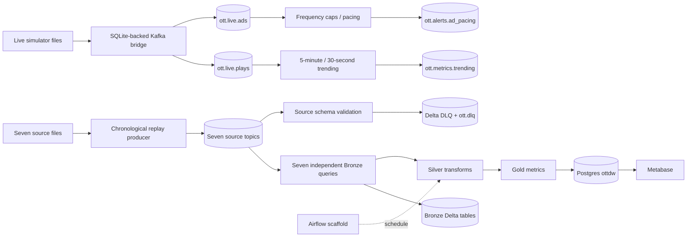

# Kafka ETL platform — StreamBharat

## Scope and topic contracts

This extension follows the separate Kafka ETL workbook. The original PySpark workbook's
Q-number mapping remains intact; the new workbook uses its own jobs and contracts.

| Stream | Topic | Partitions | Key |
|---|---|---:|---|
| Player events | ott.player.events | 6 | user_id |
| Subscription events | ott.billing.subscr | 3 | user_id |
| Gateway settlements | ott.billing.settle | 3 | user_id |
| Search logs | ott.app.search | 3 | profile_id |
| Ratings | ott.app.ratings | 1 | profile_id |
| Ad breaks | ott.ads.breaks | 3 | user_id |
| Ad impressions | ott.ads.impressions | 3 | user_id |
| Live plays | ott.live.plays | 6 | user_id |
| Live ad impressions | ott.live.ads | 6 | user_id |
| Dead-letter queue | ott.dlq | 3 | source topic/partition/offset |
| Trending output | ott.metrics.trending | 3 | window/language/rank |
| Pacing alerts | ott.alerts.ad_pacing | 3 | stable alert identifier |
| Current subscription state | ott.ref.subscription_state | 3 | user_id (compacted) |

The first seven source feeds are replayed from the course dataset. The two live topics are
fed from the supplied simulator through the producer bridge. They are separate event
contracts: the live play stream does not replace the player history source topic.

## Architecture



## Local stack

The local stack includes Kafka 3.8 KRaft, Kafka UI, Postgres 16, Metabase and a Python 3.11
workspace with Java 17, PySpark 3.5.3, Delta Lake 3.2, JupyterLab and the Confluent Kafka
client. Spark currently runs in local mode within the workspace container; a separate
Spark master/worker cluster is not included yet. The single broker, PLAINTEXT listeners
and replication factor 1 are development-only.

From the repository root:

```bash
docker compose -f docker-compose.kafka.yml up -d --build
bash config/kafka-topics.sh
docker compose -f docker-compose.kafka.yml exec workspace pytest -q
```

Services:
- Kafka UI: http://localhost:8080
- JupyterLab: http://localhost:8888 (local token: streambharat-local)
- Metabase: http://localhost:3000
- Postgres warehouse: localhost:5432, database ottdw

The supplied dataset is not stored in Git. Copy the course data directory to data/raw/
using the layout in docs/source-materials/StreamBharat-Dataset-README.md.

## Seven-source replay, Bronze and DLQ

Replay the October source data into the seven workbook topics:

```bash
docker compose -f docker-compose.kafka.yml exec workspace \
  python -m streambharat.replay_kafka --start-date 2026-10-01 --end-date 2026-10-31 --speed 0
```

For a small smoke replay, add --max-events 2000. The replay uses the field-specific event
timestamp and the workbook's partition key. Playback files are named by server-arrival
date. Ad impressions are scheduled at ad-break timestamp plus duration, as those events
are sent when the ad has finished.

Start each Bronze query with its own checkpoint:

```bash
docker compose -f docker-compose.kafka.yml exec workspace \
  bash scripts/run_bronze_ingest.sh --available-now
```

Bronze is an append-only, unparsed copy. It preserves the raw value plus topic, partition,
offset, broker timestamp, key and headers. It adds ingestion timestamp/date, partitions
by ingestion date and uses one checkpoint per source topic under lake/_checkpoints/.

Run the source-contract validator independently:

```bash
docker compose -f docker-compose.kafka.yml exec workspace \
  bash scripts/run_dlq_ingest.sh --available-now
```

The validator checks required identifiers, field types, timestamps, player position
schema-v1/schema-v2, subscription amounts, ratings, ad flags, ad duration and CPM.
Invalid records go to lake/bronze/dlq and ott.dlq with raw value and original Kafka
lineage. Delta DLQ rows are MERGEd by source topic/partition/offset. Bronze remains
unchanged even when a record is rejected by the downstream validator.

Start Bronze and DLQ in processing mode before a continuous replay; for a finished replay,
run both with --available-now. Do not delete checkpoints for normal restarts. The Kafka
Spark connector is fetched as a Maven package and needs a repository connection on first use.

The offset reconciliation report checks Bronze rows within the currently retained Kafka
[low, high) offset range. A non-zero low watermark means Kafka has already expired earlier
offsets; the report distinguishes current-retention reconciliation from proof of full
historical completeness.

## Silver player starter

After Bronze player data is available:

```bash
docker compose -f docker-compose.kafka.yml exec workspace \
  python -m streambharat.silver_player --bronze lake/bronze/player_events
```

This first Silver job parses both player schema versions, converts position_ms to seconds,
estimates per-device median clock offset from online events, preserves client time for
offline downloads, records corrected event and arrival dates, and MERGEs by event_id.
Malformed or un-timestamped events are written to a separate quarantine path. The device
offset table is retained for audit.

## Live Kafka event path

The simulator creates completed JSONL files under data/stream/plays and data/stream/ads.
The Kafka bridge reads those files, uses user_id as the Kafka key for both topics, writes
event metadata headers and persists acknowledged event identities in
lake/state/kafka_producer.sqlite3.

```bash
# Workspace terminal 1
python ott_stream_simulator.py --stream both

# Workspace terminal 2
python -m streambharat.kafka_producer --stream both

# Workspace terminal 3 — live trending
bash scripts/run_kafka_stream.sh plays

# Workspace terminal 4 — live ad pacing
bash scripts/run_kafka_stream.sh ads
```

For Q17, first create lake/silver/player_events with the Silver job. Q17 builds a
seven-day per-title/language/hour baseline from that table and then computes the Kafka
live feed using 5-minute event-time windows sliding every 30 seconds. It keeps the
12-minute late-event allowance, ranks the top 10 titles per language and writes snapshots
to both lake/gold/trending and ott.metrics.trending. The trending output topic is compacted
by window/language/rank so each rank slot retains its latest snapshot.

Q18 deduplicates impression IDs in a Delta event ledger, recomputes per-user/campaign/day
frequency counts and campaign spend, and writes current cap/pacing state to Delta. It
publishes frequency-cap and campaign-pacing events to ott.alerts.ad_pacing using stable
alert keys. The alert topic is compacted so repeated updates replace the prior state for
the same campaign/day or user/campaign/day.

Both live streaming adapters route malformed or semantically invalid records to the
Delta live DLQ and ott.dlq. Their Spark queries use independent checkpoints under
lake/_checkpoints/kafka_q17, lake/_checkpoints/kafka_q18 and
lake/_checkpoints/dlq_live_*.

## Delivery semantics and limitations

- Producer idempotence handles retriable producer sends, while SQLite records acknowledged
  events across normal bridge restarts. It is a local state file and must be retained with
  the lake and checkpoints.
- Bronze is append-only and uses an independent checkpoint per source topic.
- Silver player MERGE uses event_id as its business key.
- DLQ Delta idempotency uses source topic/partition/offset. The Delta and Kafka DLQ writes
  are separate sinks; a retry can publish a duplicate Kafka DLQ key.
- Live trending snapshots use window/language/rank keys. Pacing alerts use stable alert IDs.
  Both output topics are compacted by key.
- This platform is at-least-once with idempotent Delta effects. There is no claim of an
  atomic exactly-once transaction spanning Kafka offsets, Delta and Postgres.
- Airflow is still a scaffold, not yet wired to invoke every job in this Kafka ETL workbook.
- PostgreSQL DDL and dashboard question specifications are present, but Gold-to-Postgres
  loads and a saved Metabase dashboard still need runtime verification.
- The local stack is one Kafka broker and one local-mode Spark process. It is not
  production high availability, production security or a distributed Spark cluster.

## Validation checklist

- [ ] Compose stack starts and all thirteen Kafka topics are created with correct partitions.
- [ ] October replay publishes records to all seven source topics.
- [ ] Seven Bronze Delta tables preserve raw value and offset/header lineage.
- [ ] Retained-offset reconciliation has no unexplained count differences.
- [ ] Invalid input appears in both Delta DLQ and ott.dlq with a reason code.
- [ ] Player v1/v2 positions normalise to seconds; clock offset outliers are inspected.
- [ ] Duplicate event_id values do not duplicate Silver player rows.
- [ ] Q17 output shows 5-minute windows / 30-second slides and writes trending snapshots.
- [ ] Q18 produces frequency-cap or pacing alerts from the live simulator.
- [ ] Stop/restart streams with existing checkpoints and verify recovery.
- [ ] Capture throughput, batch duration, event freshness and processing lag.
- [ ] Gold tables load to Postgres and Metabase dashboards query actual warehouse rows.

## Remaining Kafka workbook work

The following are not complete in this implementation slice: subscription SCD2/state
machine and compacted reference producer, full nested catalog/licence/user dimension
loading, July–September player backfill, real-time sessionisation, ad break/impression
stream join and target-genre checks, complete Gold watch-time/active-user/revenue/royalty
tables, a production-grade Airflow DAG, stream metrics/lag monitoring, and failure drills.
These require additional modules and runtime validation against the supplied dataset.

## References

- Spark 3.5.3 Structured Streaming + Kafka:
  https://spark.apache.org/docs/3.5.3/structured-streaming-kafka-integration.html
- Confluent Kafka Python client:
  https://docs.confluent.io/kafka-clients/python/current/index.html
- Apache Kafka delivery semantics:
  https://kafka.apache.org/design/#semantics
